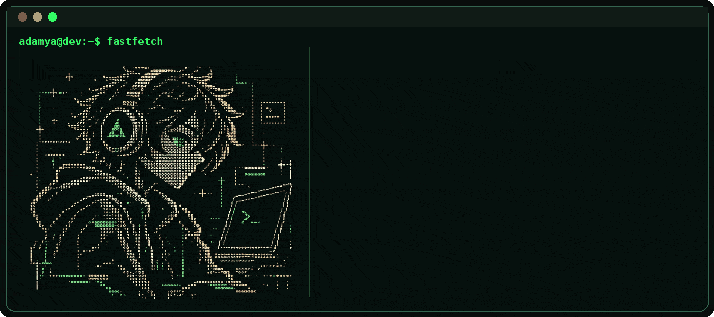
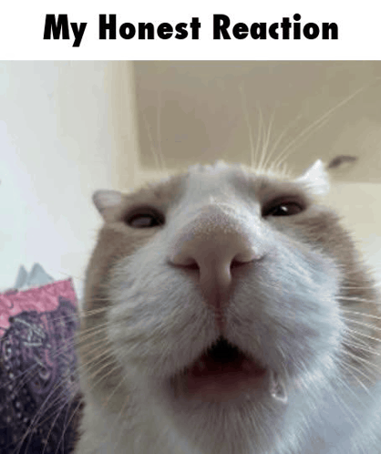
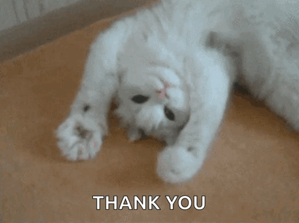

<!--
If you're reading this, you are one of the curious ones.

Most people only see the surface, but you decided to look deeper. 

Don't stop here. Take a closer look at the visual Assets kept on display. 

Keep your eyes open. You might find far more than you expected.

yvlxp://wqjup.xnw/JgE1lBZnWpvaPEbM6
-->

 

  

  

## 👨‍💻 About me
- I enjoy building things that solve real problems, exploring how systems work, and finding practical ways to make things better.
- I'm always up for learning something new, especially when it gives me a new way to approach a problem or bring an idea to life.
- Outside of coding, you'll find me playing chess, sketching, getting lost in a book, or occasionally going for a run. I like having different ways to challenge myself, express creativity, and unwind.

## 💻 Tech Stack

  

## 🌐 Find me online

  

  
   <i> Let's build something amazing together! </i> [😃](https://youtu.be/dQw4w9WgXcQ?si=_sDEwCjTkSaSHOYG)

